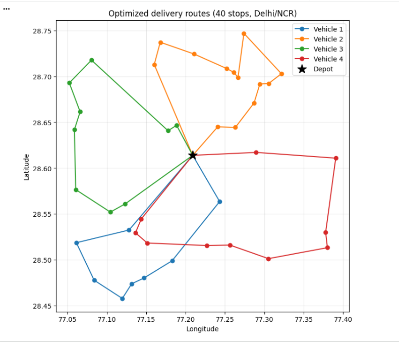

# Delivery Route Optimizer

Route optimization for delivery fleets using Google OR-Tools (Capacitated Vehicle Routing Problem).

## Problem
40 delivery stops around Delhi/NCR, one depot, vehicles with a 60-parcel capacity.

## Results (synthetic demo scenario)

| | Manual (sweep) plan | Optimized |
|---|---|---|
| Vehicles | 5 | 4 |
| Distance per day | 433 km | 290 km |
| Cost per day | Rs 10,197 | Rs 7,481 |

Optimization cut daily distance by about 33% and removed one vehicle, a reduction of roughly 25% in daily delivery cost versus a sweep-based manual plan.

## Assumptions
- Rs 12 per km running cost, Rs 1,000 per vehicle per day for the driver
- Road distance = straight-line distance x 1.3
- Synthetic data; real results depend on actual stops, traffic, and time windows

## Tech
Python, OR-Tools, Folium, Google Colab

## Contact

Naveen|www.linkedin.com/in/naveen-sehrawat-bb2082428 | naveen.du.or.27@gmail.com
